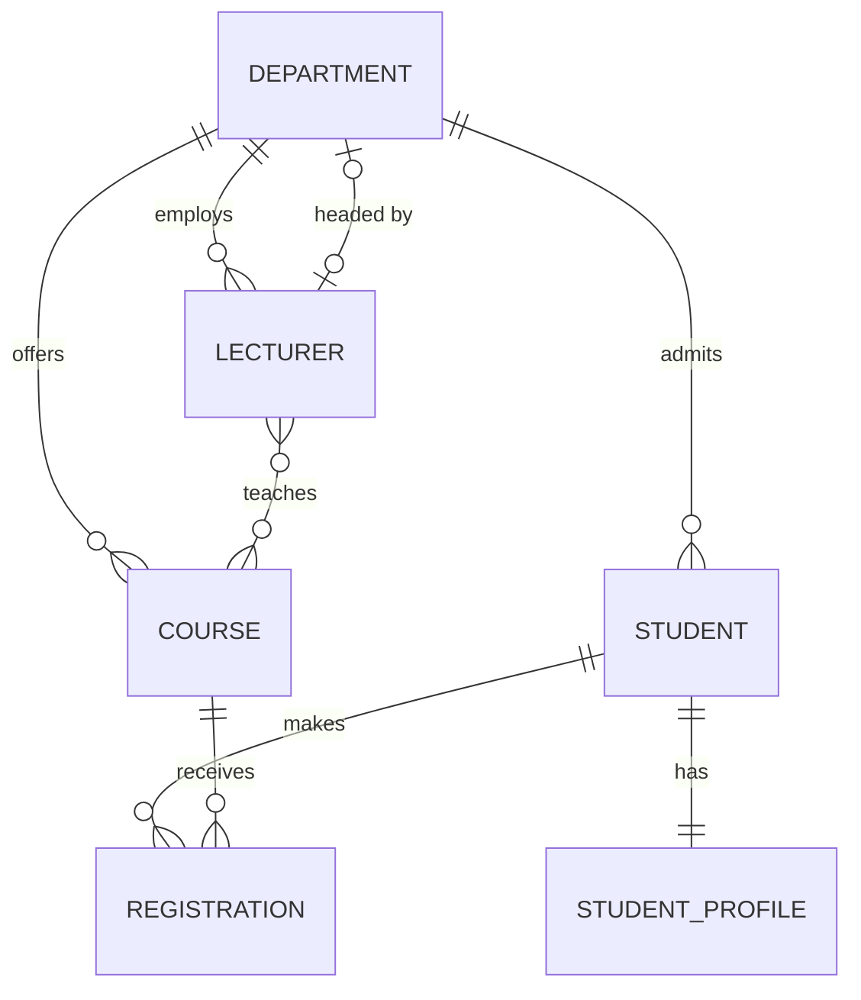

# University Course Registration and Academic Management System

**Student:** UWAKEZA KAMIKAZI Merveille  | **Reg No:** 27893

Spring Boot + Hibernate/JPA + PostgreSQL (`university_academic_db`). Model and Repository layers.

## 1. Entities
Department, Lecturer, Student, StudentProfile, Course, Registration (join entity).

## 2. Relationships
| Relationship | Cardinality | Implementation |
|---|---|---|
| Department - Course | One-to-Many | FK `department_id` in `course` |
| Department - Lecturer (employs) | One-to-Many | FK `department_id` in `lecturer` |
| Department - Lecturer (head) | One-to-One | FK `head_id` in `department` |
| Department - Student | One-to-Many | FK `department_id` in `student` |
| Student - StudentProfile | One-to-One | FK `student_id` (unique) in `student_profile` |
| Lecturer - Course | Many-to-Many | Join table `lecturer_course` (no entity) |
| Student - Course | Many-to-Many with attributes | Join entity `Registration` |

## 3. ERD

## 4. Relational Schema
- department(**id**, name, code, head_id → lecturer.id)
- lecturer(**id**, first_name, last_name, email, department_id → department.id)
- student(**id**, first_name, last_name, email, registration_number, department_id → department.id)
- student_profile(**id**, date_of_birth, gender, phone_number, address, student_id → student.id)
- course(**id**, code, title, credits, department_id → department.id)
- lecturer_course(**lecturer_id**, **course_id**) both FKs
- registration(**id**, registration_date, academic_year, semester, status, grade, student_id → student.id, course_id → course.id)

## 5. Screenshots

